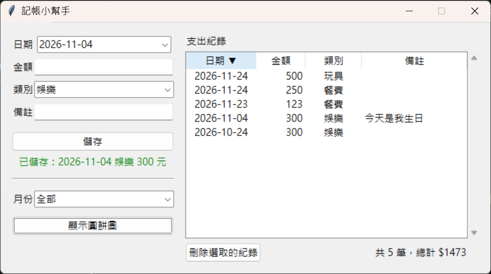
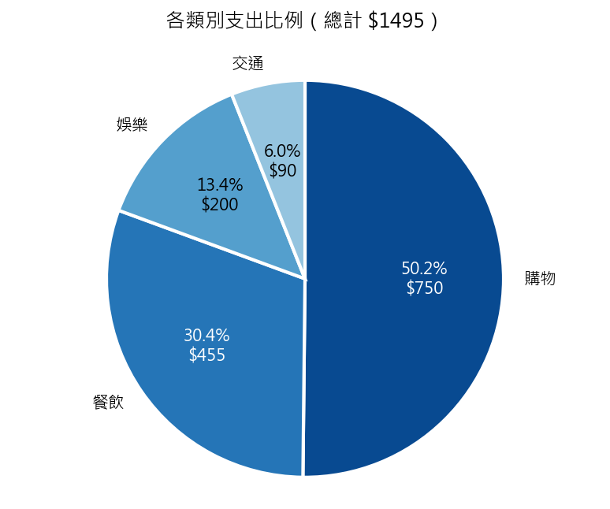

# 記帳工具（Expense Tracker）

軟體工程導論 作業一：兩人協作的 Python 記帳工具。
可以輸入每筆支出、查看支出紀錄，並依類別畫出圓餅圖。提供**圖形介面**和**命令列**兩種使用方式。

## 分工
| 模組 | 檔案 | 負責人 | 分支 |
|---|---|---|---|
| 輸入模組 | `expense_input.py`、`expense_gui.py` | 1132951莊雅筑 | `input_module`、`gui`、`feature_delete` |
| 圓餅圖模組 | `pie_chart.py` | 1132959張芸芸 | `visualization_module`、`feature_pie_enhance` |

## 檔案說明
| 檔案 | 說明 |
|---|---|
| `expense_gui.py` | 圖形介面主程式（輸入、紀錄列表、圓餅圖） |
| `expense_input.py` | 命令列版輸入程式，也提供輸入檢查與存檔函式給 GUI 使用 |
| `pie_chart.py` | 讀取資料並依類別畫圓餅圖 |
| `expenses.csv` | 支出資料（第一次執行時自動建立） |
| `sample_expenses.csv` | 範例資料，用來測試圓餅圖 |
| `requirements.txt` | 需要安裝的套件清單 |

## 安裝
需要 Python 3、matplotlib、tkcalendar。
在專案資料夾執行：
```
python -m pip install -r requirements.txt
```

## 使用方式

### 方法一：圖形介面
```
python expense_gui.py
```



**輸入支出**
- **日期**：可以直接輸入，或點右邊的箭頭用月曆選擇，預設為今天
- **金額**：正整數
- **類別**：從下拉選單選擇（餐飲、交通、娛樂、購物、生活用品、其他），也可以自行輸入
- **備註**：可空白
- 按「儲存」或按 Enter 存檔。輸入有誤會跳出提示視窗，不會存入錯誤的資料
- 存檔後會保留日期和類別、清空金額和備註，方便連續輸入

**支出紀錄列表**
- 右側列出所有紀錄，下方顯示筆數和總金額
- 點欄位標題可以切換排序方式（▼ 由大到小、▲ 由小到大）
- 點選紀錄後按「刪除選取的紀錄」或鍵盤 Delete 鍵可以刪除（可按住 Ctrl 多選，刪除前會再確認一次）

**圓餅圖**
- 選擇月份（或「全部」），按「顯示圓餅圖」，會在新視窗顯示該月份各類別的支出比例

### 方法二：命令列
**1. 輸入支出**
```
python expense_input.py
```
依照提示輸入日期 (YYYY-MM-DD，直接按 Enter 代表今天)、金額（正整數）、類別、備註（可空白），可以連續輸入多筆。
輸入格式錯誤時會顯示原因並重新詢問。資料會存到 `expenses.csv`。在日期欄輸入 `q` 可離開。

**2. 畫圓餅圖**
```
python pie_chart.py
```
讀取 `expenses.csv`，依類別加總金額並顯示圓餅圖，同時存成 `pie_chart.png`。

圓餅圖功能：
- 每一塊顯示百分比和金額，標題顯示總支出
- 藍色漸層配色，依金額由大到小排序（越深代表金額越大）
- 可以只看某個月份的支出

### 進階用法（在其他程式中使用）
```python
import pie_chart

pie_chart.draw_pie_chart("expenses.csv")                          # 畫全部
pie_chart.draw_pie_chart("expenses.csv", month="2026-11")         # 只畫 2026 年 11 月
pie_chart.draw_pie_chart("expenses.csv", save_path="out.png")     # 存成圖片
fig = pie_chart.draw_pie_chart("expenses.csv", show=False)        # 不跳視窗，回傳 fig（給 GUI 用）
```

`expense_input.py` 的檢查與存檔函式也可單獨使用：
```python
from expense_input import parse_date, parse_amount, parse_category, save_expense

amount = parse_amount("120")      # 格式錯誤時會丟出 ValueError，訊息說明錯誤原因
save_expense("2026-11-24", amount, "餐飲", "午餐")
```

用範例資料試跑圓餅圖：
```
python -c "import pie_chart; pie_chart.draw_pie_chart('sample_expenses.csv')"
```

## 資料格式
`expenses.csv`（編碼 utf-8-sig）：

| 欄位 | 說明 |
|---|---|
| date | 日期，YYYY-MM-DD |
| amount | 金額，正整數 |
| category | 類別，例如 餐飲、交通 |
| notes | 備註，可空白 |

## 範例圓餅圖
使用 `sample_expenses.csv` 產生：



